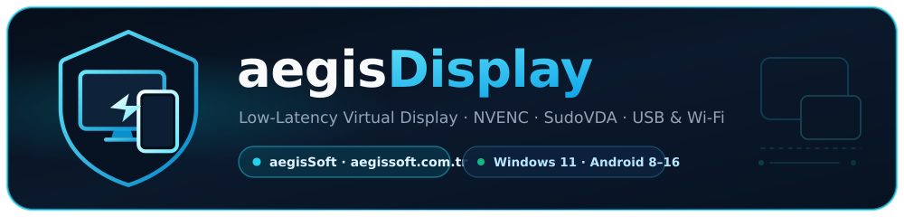
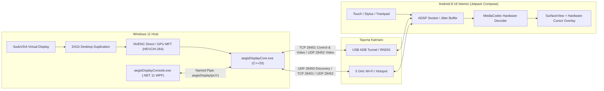
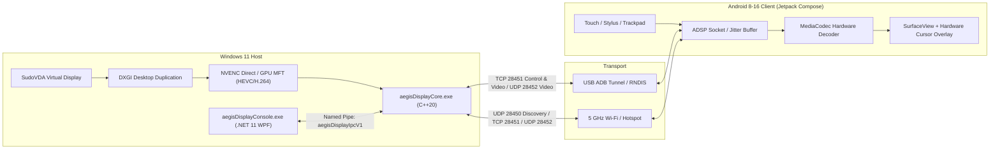
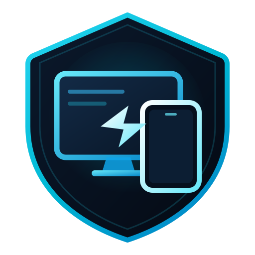

<div align="center">



<br />
<br />

<a href="#turkce"> <strong>Türkçe</strong></a>
&nbsp;&nbsp;&middot;&nbsp;&nbsp;
<a href="#english"> <strong>English</strong></a>

<br />
<br />

[](https://aegissoft.com.tr)
[](https://github.com/MrSpy00/aegisDisplay)
[](https://github.com/MrSpy00/aegisDisplay/releases/latest)
[](#turkce)
[](LICENSE)

</div>

---

<a id="turkce"></a>

##  Türkçe

**aegisDisplay**, Windows 11 masaüstü ortamını USB (ADB tüneli / RNDIS) veya Wi-Fi/Hotspot üzerinden Android telefon ve tabletlere **donanım hızlandırmalı, ultra düşük gecikmeli gerçek ikinci monitör (Extend Desktop)** olarak aktaran kurumsal kalitede açık kaynaklı bir sanal ekran sistemidir.

[aegisSoft](https://aegissoft.com.tr) mimarisiyle **mrSpy** ([MrSpy00](https://github.com/MrSpy00)) tarafından geliştirilmiştir.

### Öne Çıkan Özellikler

* **Gerçek Sanal Monitör (SudoVDA / IDD):** Windows `Indirect Display Driver` (`SudoVDA`) tabanlı sürücü ile ekstra HDMI/DP dummy plug gerektirmeden `Extend` modunda fiziksel olmayan gerçek Windows monitörü oluşturur; 60 / 90 / 120 Hz yenileme hızlarını ve özel çözünürlükleri destekler.
* **Donanım Hızlandırmalı Kodlama & Çözme:**
  * **Windows Host (`aegisDisplayCore.exe`):** DXGI Desktop Duplication API + NVIDIA NVENC Direct (`HEVC` / `H.264`), AMD/Intel GPU Media Foundation Transform (`MFT`) ve yazılım (`x264`/MF) fallback zinciri; sıfır kopya GPU kare yakalama.
  * **Android İstemci (`com.aegissoft.aegisdisplay`):** Donanım `MediaCodec` (`video/hevc`, `video/avc`) düşük gecikmeli yüzey (`SurfaceView`) çözümleme, 0-kare düşürme hedefi ve donanım imleç (`CURSOR_SHAPE` / `CURSOR_MOVE`) bindirmesi.
* **Çift Taşıma Katmanı (USB + LAN/Wi-Fi):**
  * **USB ADB Tüneli:** `adb reverse` (`TCP 28451` / `UDP 28452`) ile sıfır yönlendirici bağımlılığı ve tek haneli milisaniye kodlama süresi (`~3.5 ms` NVENC).
  * **Ağ Modu:** mDNS/UDP Broadcast (`UDP 28450`) otomatik sunucu keşfi veya manuel IP bağlantısı.
* **Gelişmiş Giriş Modları (Touch, Stylus & Trackpad):**
  * **Direct Touch:** 10 nokta çoklu dokunmatik ekran girişi ve stylus basınç (`pressure`) / eğim (`tilt`) desteği.
  * **Trackpad (`MOUSE_RELATIVE`):** Telefon ekranını dizüstü dokunmatik yüzeyi gibi kullanarak Windows imlecini bağıl (`dx`, `dy`) kontrol etme ve sol/sağ tıklama.
  * **View Only:** Salt görüntüleme modu (ekran kazara dokunuşlarını yok sayar).
* **Temiz & Kapanabilir Yayın HUD'ı:** Yayın sırasında ekran alanında yer kaplamayan sıfır piksellik gizlenebilir kontrol arayüzü (`HUD`): 4 saniye otomatik gizlenme, 3 parmak dokunuşla aç/kapat, Sistem Geri tuşu veya bildirim aksiyonu ile hızlı geçiş ve kalıcı ayarlar.
* **MagicOS & OEM Pil Yönetimi Uyumu:** Honor MagicOS (`PowerGenie`), Xiaomi HyperOS ve Samsung OneUI gibi agresif arka plan sonlandırıcılarına karşı Foreground Service (`mediaPlayback`/`connectedDevice`), WakeLock ve rehberli pil muafiyeti desteği.
* **Modern Masaüstü Konsolu (`aegisDisplayConsole.exe`):** .NET 11 WPF arayüzü, sistem tepsisi (System Tray) entegrasyonu, gerçek zamanlı FPS / Bitrate / Kodlama gecikmesi (`encodeMs`) / Ağ RTT telemetrisi ve kalıcı gelişmiş sunucu-kodlayıcı ayarları.

### Mimari ve Protokol Özeti



| Kanal / Port | Protokol | Amaç |
| :--- | :--- | :--- |
| **28450** | UDP | Host yayın keşfi (`DISCOVER_REQ` / `DISCOVER_ACK`) |
| **28451** | TCP | Oturum el sıkışması (`HELLO`), kontrol mesajları, giriş olayları (`INPUT_TOUCH`, `MOUSE_RELATIVE`, `KEYBOARD`) ve güvenilir video akışı |
| **28452** | UDP | Düşük gecikmeli video kare parçaları (`VIDEO_FRAME`, FEC/sıra numaralı akış) |
| **Named Pipe** | `\\.\pipe\aegisDisplayIpcV1` | Windows Konsol ile Core servisi arası durum ve yapılandırma IPC kanalı |

### Sistem Gereksinimleri

* **Windows Host:** Windows 11 (x64, `22H2+`), WDDM 3.0+ GPU sürücüsü (NVIDIA RTX/GTX NVENC, AMD AMF veya Intel QuickSync önerilir), masaüstü konsolu için `.NET Desktop Runtime 11` (veya taşınabilir kurulum gereksinimleri).
* **Android İstemci:** Android 8.0 (`API 26`) – Android 16 (`API 36`), donanım HEVC veya H.264 `MediaCodec` desteği.

### Kurulum ve Hızlı Başlangıç

#### 1. İndirme

En güncel sürüm paketlerini [GitHub Releases](https://github.com/MrSpy00/aegisDisplay/releases/latest) sayfasından indirin:

* `aegisDisplay-v1.0.0-win-x64-portable.zip` (Windows Core + WPF Console + SudoVDA Sürücüleri + Kurulum Betikleri)
* `aegisDisplay-v1.0.0-android.apk` (İmzalı Android İstemcisi)
* Bütünlük doğrulaması için `SHA256SUMS.txt`

#### 2. Windows Sanal Ekran Sürücüsünün Kurulması

Yönetici (Administrator) PowerShell oturumunda kurulum betiğini çalıştırın:

```powershell
# SudoVDA sanal ekran sürücüsünü yükler ve Windows Firewall portlarını yapılandırır
.\scripts\install-driver.ps1
```

Ardından `aegisDisplayConsole.exe` uygulamasını başlatın. Core servisi otomatik olarak başlatılır ve sistem tepsisinde simgesi görünür.

#### 3. Android Bağlantısı (USB veya Wi-Fi)

* **USB Kablosu (En Düşük Gecikme — Önerilen):**
  1. Telefonda *Geliştirici Seçenekleri > USB Hata Ayıklama* özelliğini açın.
  2. Bilgisayarda `.\scripts\adb-usb-connect.ps1` betiğini çalıştırın (`adb reverse tcp:28451 tcp:28451`).
  3. Android uygulamasında **USB / Localhost (`127.0.0.1`)** seçeneğine dokunup **Bağlan** butonuna basın.
* **Wi-Fi / Hotspot:**
  1. Telefon ve PC'nin aynı 5 GHz ağda olduğundan emin olun.
  2. Android uygulaması otomatik keşif (`UDP 28450`) ile PC'yi listeler; gerekirse **Manuel IP** girin ve **Bağlan** butonuna basın.

### Yayın Sırası Kontrolleri ve Ayarlar

* **HUD Gizleme / Açma:** Yayın başladıktan 4 saniye sonra HUD otomatik olarak tamamen gizlenir (ekran üzerinde yüzen buton kalmaz). Tekrar açmak için **3 parmakla dokunun**, Android **Geri** tuşunu kullanın veya bildirim panelindeki **Kontrolleri Göster** düğmesine dokunun.
* **Gelişmiş Ayarlar (Android & Windows):**
  * Özel çözünürlük (`Genişlik x Yükseklik`), hedef FPS (`30–120 Hz`) ve Bitrate (`4–60 Mbps`).
  * Codec seçimi (`Otomatik / HEVC / H.264`), düşük gecikme kilitli modu, donanım imleç senkronizasyonu.
  * MagicOS / OEM pil optimizasyonu muafiyeti kısayolu.

### Kaynaktan Derleme (Build from Source)

Gereksinimler: Visual Studio 2022 / CMake (`C++20`), .NET 11 SDK, JDK 21+, Android SDK (`API 36`).

```powershell
# Tüm bileşenleri (C++ Core, WPF Console, CTest, xUnit ve Android APK) derler ve test eder
.\scripts\build-all.ps1 -Configuration Release
```

### Güvenlik ve Gizlilik

* Tüm video akışı ve giriş olayları yalnızca yerel ağ (`LAN`) veya USB ADB tüneli üzerinden iletilir; harici bulut sunucusuna telemetri veya ekran görüntüsü gönderilmez.
* Üçüncü taraf paketlerden bağımsız açık protokol ve yerel dosya bütünlüğü (`SHA256SUMS.txt`) sağlanır.

### Lisans

Bu proje **MIT Lisansı** altında sunulmaktadır. Sanal ekran sürücü bileşeni ([SudoVDA](https://github.com/SudoMaker/SudoVDA)) ve NVIDIA Video Codec SDK başlıklarına ait üçüncü taraf lisans bildirimleri [LICENSE](LICENSE) dosyasında yer almaktadır.

---

<a id="english"></a>

##  English

**aegisDisplay** is an enterprise-grade, open-source virtual display system that extends your Windows 11 desktop to Android phones and tablets over USB (ADB tunnel / RNDIS) or Wi-Fi/Hotspot with **hardware-accelerated, ultra-low-latency streaming**.

Built under the [aegisSoft](https://aegissoft.com.tr) engineering architecture by **mrSpy** ([MrSpy00](https://github.com/MrSpy00)).

### Key Features

* **True Windows Extended Display (SudoVDA / IDD):** Creates a genuine Windows Indirect Display without requiring physical HDMI/DisplayPort dummy plugs; supports 60 / 90 / 120 Hz refresh rates and arbitrary custom resolutions.
* **Hardware-Accelerated Encoding & Decoding:**
  * **Windows Host (`aegisDisplayCore.exe`):** DXGI Desktop Duplication API + zero-copy GPU capture feeding NVIDIA NVENC Direct (`HEVC` / `H.264`), AMD/Intel GPU Media Foundation Transform (`MFT`), and automatic software fallback.
  * **Android Client (`com.aegissoft.aegisdisplay`):** Hardware `MediaCodec` (`video/hevc`, `video/avc`) low-latency rendering onto `SurfaceView` with hardware cursor (`CURSOR_SHAPE` / `CURSOR_MOVE`) overlay compositing.
* **Dual Transport Layer (USB + LAN/Wi-Fi):**
  * **USB ADB Tunnel:** Zero router dependency via `adb reverse` (`TCP 28451` / `UDP 28452`) achieving single-digit encode times (`~3.5 ms` on NVENC).
  * **Wireless / Hotspot Mode:** Automatic LAN discovery (`UDP 28450`) or direct manual IP connection.
* **Versatile Input Modes (Touch, Stylus & Trackpad):**
  * **Direct Touch:** 10-point multi-touch forwarding plus stylus pressure and tilt support.
  * **Trackpad (`MOUSE_RELATIVE`):** Relative cursor deltas (`dx`, `dy`) and left/right click gestures turning your device into a precision desktop trackpad.
  * **View Only:** Passive monitor mode ignoring accidental touches.
* **Zero-Pixel Hideable Stream HUD:** While streaming, the overlay can be completely dismissed leaving zero floating buttons on screen: 4-second auto-hide, 3-finger tap toggle, system Back gesture, and persistent Android notification quick toggle.
* **MagicOS & Aggressive OEM Battery Compatibility:** Foreground Service (`mediaPlayback`/`connectedDevice`), WakeLock protection, and built-in battery exemption prompts engineered for Honor MagicOS (`PowerGenie`), HyperOS, and OneUI.
* **Modern Desktop Console (`aegisDisplayConsole.exe`):** .NET 11 WPF management UI with system tray integration, real-time FPS / Bitrate / `encodeMs` / RTT telemetry, and persistent server/encoder configuration.

### Architecture & Protocol Overview



| Port / Channel | Protocol | Purpose |
| :--- | :--- | :--- |
| **28450** | UDP | Host discovery broadcast (`DISCOVER_REQ` / `DISCOVER_ACK`) |
| **28451** | TCP | Handshake (`HELLO`), control messages, input events (`INPUT_TOUCH`, `MOUSE_RELATIVE`, `KEYBOARD`), and reliable frame delivery |
| **28452** | UDP | Low-latency sequenced video packets (`VIDEO_FRAME`) |
| **Named Pipe** | `\\.\pipe\aegisDisplayIpcV1` | Local IPC bridge between the WPF Console and the C++20 Core daemon |

### System Requirements

* **Windows Host:** Windows 11 (x64, `22H2+`), WDDM 3.0+ GPU driver (NVIDIA NVENC, AMD AMF, or Intel QuickSync recommended), `.NET Desktop Runtime 11` for the management console.
* **Android Client:** Android 8.0 (`API 26`) through Android 16 (`API 36`) with hardware HEVC or H.264 `MediaCodec` decoder support.

### Quick Start & Installation

#### 1. Download Release Artifacts

Grab the latest verified build from [GitHub Releases](https://github.com/MrSpy00/aegisDisplay/releases/latest):

* `aegisDisplay-v1.0.0-win-x64-portable.zip` (Windows Core + WPF Console + SudoVDA Driver + Setup Scripts)
* `aegisDisplay-v1.0.0-android.apk` (Signed Android Client)
* `SHA256SUMS.txt` (Cryptographic checksums for all artifacts)

#### 2. Install the Windows Virtual Display Driver

Run the installer script from an **elevated (Administrator) PowerShell** prompt:

```powershell
# Registers the SudoVDA Indirect Display Driver and configures local firewall rules
.\scripts\install-driver.ps1
```

Launch `aegisDisplayConsole.exe` — the Core service starts automatically and minimizes to the system tray.

#### 3. Connect Your Android Device (USB or Wi-Fi)

* **USB Cable (Lowest Latency — Recommended):**
  1. Enable *Developer Options > USB Debugging* on Android.
  2. Run `.\scripts\adb-usb-connect.ps1` on Windows (`adb reverse tcp:28451 tcp:28451`).
  3. Open `aegisDisplay` on Android, select **USB / Localhost (`127.0.0.1`)**, and tap **Connect**.
* **Wi-Fi / Hotspot:**
  1. Ensure both devices share the same 5 GHz subnet.
  2. Select your host from automatic discovery (`UDP 28450`) or enter its **Manual IP** and tap **Connect**.

### In-Stream Controls & Advanced Settings

* **Zero-Clutter HUD:** The floating toolbar fades out completely after 4 seconds so zero pixels obstruct your workspace. Bring it back anytime with a **3-finger tap**, Android **Back**, or the **Show Controls** action in the persistent notification.
* **Granular Tuning:** Independently configure custom `Width x Height`, `30–120 Hz` refresh rate, `4–60 Mbps` target bitrate, `HEVC / H.264 / Auto` codec selection, input mode (`Touch` / `Trackpad` / `View Only`), and encoder latency priority.

### Building from Source

Prerequisites: Visual Studio 2022 / CMake (`C++20`), .NET 11 SDK, JDK 21+, Android SDK (`API 36`).

```powershell
# Builds C++ Core, WPF Console, runs CTest + xUnit tests, and builds/tests the Android APK
.\scripts\build-all.ps1 -Configuration Release
```

### Security & Privacy

* Zero external telemetry, analytics, or cloud relay — all display frames and input packets remain strictly on your local USB tunnel or LAN.
* Every release asset ships alongside `SHA256SUMS.txt` for independent hash verification.

### License & Attribution

Released under the **MIT License** — see [LICENSE](LICENSE) for full terms and third-party attributions (`SudoVDA`, `ffnvcodec`).

---

<div align="center">



<br />

Developed by <strong>mrSpy</strong> (<a href="https://github.com/MrSpy00">MrSpy00</a>) &middot; <a href="https://aegissoft.com.tr"><strong>aegisSoft</strong></a>

</div>
